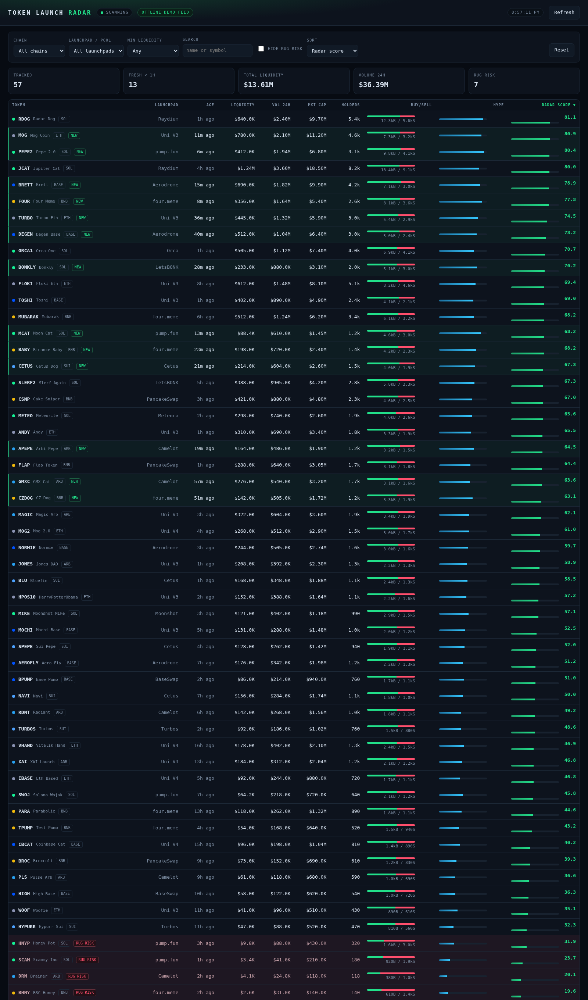
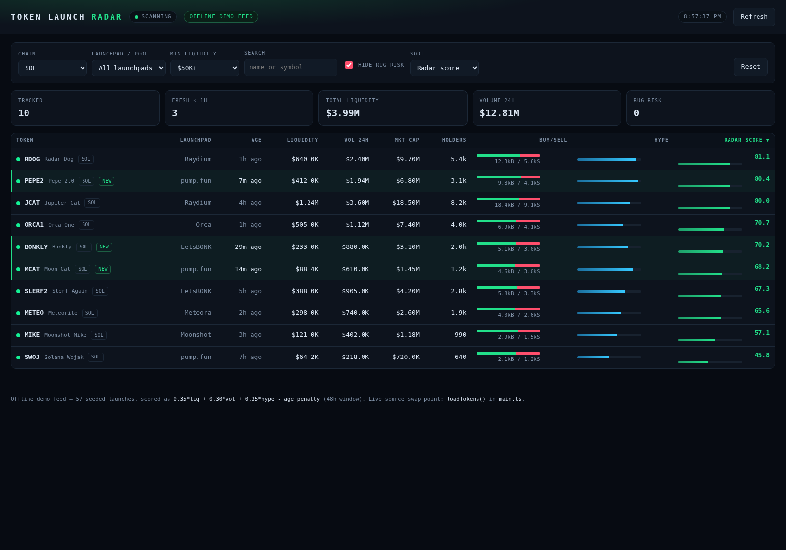
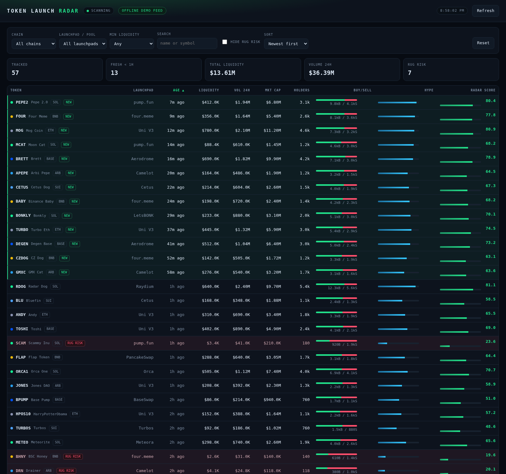

# Token Launch Radar

A single-page **token launch radar**: it aggregates recent DEX and launchpad
launches across chains, scores each one by market signal, and ranks them so the
hottest new listings float to the top.

Everything runs on Node's standard library — **no npm dependencies, no build
step, no network access required**. A bundled dataset of 57 realistic launches
stands in for a live feed, so the server works fully offline.



## Run it

Requires **Node 22.18+** (native TypeScript type stripping).

```sh
node main.ts                 # http://127.0.0.1:8000
PORT=9000 node main.ts       # custom port
```

Then open <http://127.0.0.1:8000/>.

## Tests

```sh
node --test test/
```

22 tests cover the dataset invariants and every pure function in `lib/radar.ts`
(normalisation, age decay, scoring, filters, sorting, facet extraction, query
parsing).

## What it does

**Radar score.** Each launch is normalised onto a 0–1 log scale and combined:

```
score = clamp(100 * (0.35 * liquidity + 0.30 * volume + 0.35 * hype)
              - age_penalty, 0, 100)
```

- `liquidity` and `volume` use `logScale()` so a $10M pool does not drown a
  promising $200K one.
- `age_penalty` grows linearly to a maximum of 30 points across a 48 hour
  window: identical launches lose ground as they age out of the radar.
- `rugged` tokens keep their raw score but are flagged in the UI, since the
  score measures momentum, not safety.

**Filters** — chain, launchpad/pool, minimum liquidity, hide rug-risk, and a
free-text search over name and symbol. Every filter is a server-side query
parameter, and the sort is too, so a dashboard URL is shareable.

**Dashboard** — dark radar theme, sortable columns, a score bar and a buy/sell
pressure bar per token, `NEW` badges and a green rail on launches younger than
an hour, and `12m ago`-style age labels. It refreshes every 20 seconds.

| Filtered to one chain | Sorted by freshness |
| --- | --- |
|  |  |

## HTTP API

`GET /api/tokens` returns JSON:

```jsonc
{
  "source": "offline-demo",
  "now": 1795009655,
  "total": 57,
  "count": 12,
  "filters": { "chain": "SOL", "minLiquidity": 50000, "hideRugged": true },
  "sort": { "key": "score", "dir": "desc" },
  "facets": { "chains": ["ARB", "BASE", "BNB", "ETH", "SOL", "SUI"],
              "launchpads": ["Aerodrome", "BaseSwap", "..."] },
  "tokens": [
    {
      "id": "sol-pepe2", "name": "Pepe 2.0", "symbol": "PEPE2", "chain": "SOL",
      "launchpad": "pump.fun", "launch_ts": 1795009415,
      "liquidity_usd": 412000, "volume_24h_usd": 1940000, "market_cap_usd": 6800000,
      "holders": 3120, "buys": 9840, "sells": 4120, "hype_score": 94, "rugged": false,
      "score": 80.4, "age_seconds": 240, "age_label": "4m ago"
    }
  ]
}
```

Unset filters are omitted; `minLiquidity` and `hideRugged` are always present.

Query parameters:

| Parameter | Meaning |
| --- | --- |
| `chain` | Exact chain, e.g. `SOL`, `ETH`, `BNB`, `BASE`, `ARB`, `SUI` |
| `launchpad` | Exact launchpad or pool, e.g. `pump.fun`, `Uniswap V3`, `four.meme` |
| `min_liquidity` | USD floor (alias: `minLiquidity`) |
| `no_rugged` | `1`/`true`/`yes`/`on` hides rug-risk tokens (alias: `hideRugged`) |
| `q` | Case-insensitive match on name or symbol |
| `sort` | `score`, `age`, `liquidity`, `volume`, `market_cap`, `hype`, `holders`, `buys` |
| `dir` | `asc` or `desc` (default `desc`; `age asc` is newest first) |

Anything else returns `404`. The `facets` object is computed from the **full**
dataset, so filter dropdowns stay populated after a filter is applied.

## Layout

```
main.ts             HTTP server, JSON API, inline HTML/CSS/JS dashboard
data/tokens.ts      57-token seed dataset + in-memory materialisation
lib/radar.ts        pure scoring, filtering, sorting and parsing logic
test/radar.test.ts  node:test suite
screenshots/        dashboard captures
```

## Going live

The runtime touches no network. Exactly one function bridges data into the
radar:

```ts
// main.ts
function loadTokens(): Token[] {
  return TOKENS;   // swap for a fetch of DexScreener / pump.fun / pool logs
}
```

`lib/radar.ts` is pure and source-agnostic: it scores whatever it is handed,
and `TOKENS` is materialised at module load from `age_min` offsets so the seed
data always reads as "launched minutes ago". Replace `loadTokens()` with a
cached poller and the API, filters and dashboard keep working unchanged.

## License

MIT — see [LICENSE](LICENSE).
